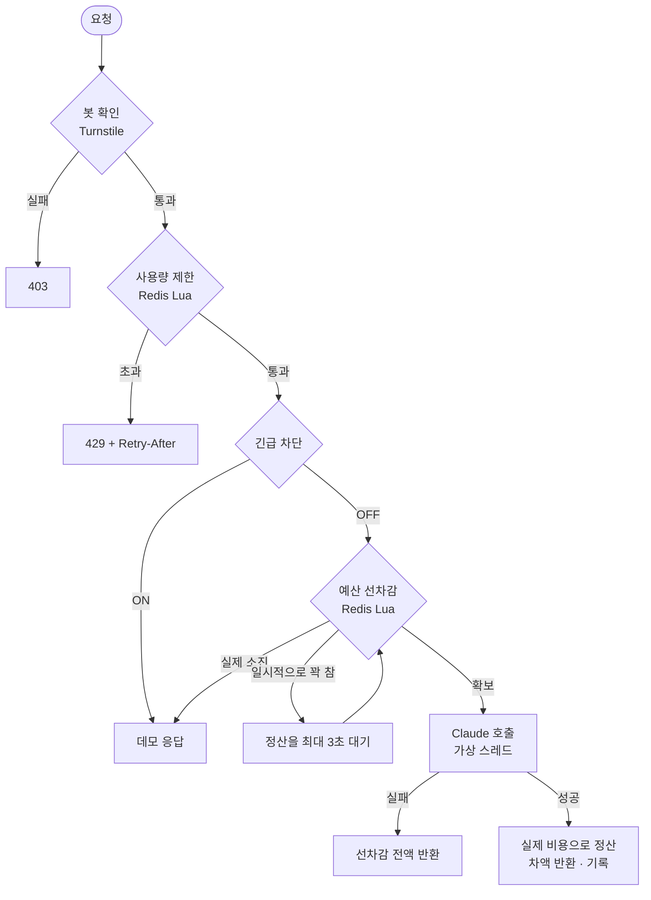
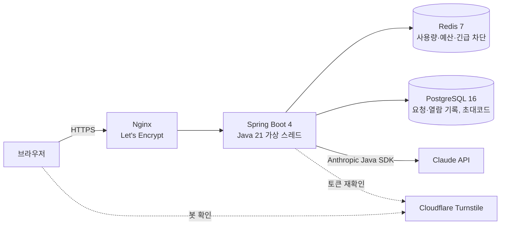

# AI 비용 방어 게이트웨이 (spring-llm-gateway)

> 공개 AI 데모를 **내 API 키**로 운영해도, 비용이 하루 정해진 금액을 넘지 않고 봇과 장애로부터 안전하게 막아주는 Spring Boot 서버

**[▶ 프로젝트 소개 + 직접 체험](https://minunglee.cloud/gateway)** · [포트폴리오 메인](https://minunglee.cloud) · [부하 테스트 문서](loadtest/README.md)

| 처리량 | 서버 안 처리 시간 | 가상 스레드 효과 | 예산 초과 |
| :---: | :---: | :---: | :---: |
| **1,771건/초** | **p95 20ms** | **처리량 2.1배** | **0건** |
| 동시 50명 | 사용량 제한·예산·정산 포함 | AI 응답 2초 · 동시 500명 | 동시 1,000건 투입 |

<sub>카페24 가상서버(vCPU 4, RAM 2GB)에서 운영과 같은 구성의 복제본으로 k6 측정</sub>

---

## 왜 만들었나

누구나 쓸 수 있는 AI 체험을 공개하면 호출 한 번 한 번이 내 API 키의 비용이 됩니다.

| 위험 | 이 프로젝트의 대응 |
| --- | --- |
| 스크립트로 반복 호출해 **비용 폭주** | Cloudflare Turnstile 봇 확인 + IP·초대코드별 사용량 제한 |
| "예산이 남았나?" 확인과 차감 사이에 **동시 요청이 함께 통과** | Redis Lua 스크립트로 확인과 차감을 한 번에(원자적으로) |
| AI 응답 전에는 **비용을 알 수 없음** | 최대 비용을 먼저 잡고(선차감) 실제 사용량으로 정산 |
| AI 응답을 기다리는 동안 **스레드가 묶임** | Java 21 가상 스레드 |
| 비용을 확인할 수 없는 **장애 상황** | 호출하지 않음 (fail-closed), 관리자 긴급 차단 |

## 요청 하나가 지나가는 길



체험 화면에서는 이 단계를 요청마다 그대로 보여줍니다 ("게이트웨이가 방금 한 일").

```
✓ 봇 확인       사람이 보낸 요청으로 확인                 Cloudflare Turnstile
✓ 사용량 제한   이번 시간 4회 · 오늘 19회 남음             Redis Lua 토큰 버킷
✓ 예산 선차감   $0.000525 확보 (나올 수 있는 최대 비용)     Redis Lua
✓ Claude 호출   claude-haiku-5-5 · 입력 6 · 출력 32 토큰    Anthropic Java SDK
✓ 정산          실제 $0.000017 사용 → $0.000508 반환        Redis INCRBY
```

## 핵심 설계

### 1. Redis Lua로 원자적 사용량 제한 — [`rate_limit.lua`](src/main/resources/scripts/rate_limit.lua)
- **문제**: 조회 → 계산 → 저장을 애플리케이션에서 나눠 하면 동시 요청이 같은 값을 읽고 함께 통과한다.
- **해결**: 시간당 토큰 버킷과 하루 카운터를 Lua 스크립트 하나로 실행. Redis가 스크립트를 한 번에 처리해 중간에 끼어들 틈이 없다. `MULTI/EXEC`는 중간 결과로 분기할 수 없어 맞지 않는다.

### 2. 최대 비용 선차감 → 실제 비용 정산 — [`BudgetGuard`](src/main/java/io/github/minunglee/gateway/limit/BudgetGuard.java)
- **문제**: AI 응답이 오기 전에는 비용을 알 수 없다. 응답 후에 차감하면 동시 요청이 몰릴 때 한도를 넘는다.
- **해결**: `입력 상한 + max_tokens` 기준 최대 비용을 먼저 확보하고, 응답의 실제 토큰 수로 차액을 돌려준다. 실패하면 전액 반환.
- **개선**: 부하 테스트에서 요청이 몰리면 실제로는 18%만 쓰고도 "예산 소진"이 되는 문제를 발견. 정산 전 선차감액을 따로 집계해 "실제 소진"과 "일시적으로 꽉 참"을 구분하고, 후자는 정산을 최대 3초 기다리게 했다. → **AI 처리 103건 → 540건, 예산 활용 17.5% → 92%, 한도 초과 0**

### 3. 가상 스레드로 느린 외부 API 대기 — [부하 테스트](loadtest/README.md#2-느린-ai-응답에서-동시-접속-가상-스레드-효과)
- **문제**: AI 응답 2초 동안 톰캣 스레드 200개가 모두 묶이면 처리량이 초당 100건(200 ÷ 2)에서 막힌다.
- **해결**: Java 21 가상 스레드. 대기 중 OS 스레드를 놓아준다.
- **결과**: 동시 500명에서 **초당 91건 → 190건**, 응답 시간 p95 **5.16초 → 2.19초**. 계산값과 측정값이 일치.

### 4. 등급별 예산과 회사별 초대코드 — [`invite`](src/main/java/io/github/minunglee/gateway/invite)
- **문제**: 게스트가 예산을 다 쓰면 정작 면접관이 데모를 보지 못한다.
- **해결**: 게스트·초대코드 예산을 분리. 회사마다 초대코드를 발급(원문은 저장하지 않고 SHA-256 해시만)하고, HMAC 서명 쿠키로 기억. 초대코드 사용자는 더 좋은 모델(Sonnet)과 넉넉한 한도를 받는다. 열람 기록은 본인 전용 관리자 대시보드에서만 확인.

### 그 밖의 결정
| 결정 | 이유 |
| --- | --- |
| 비용을 **마이크로달러 정수**로 저장 | 단가가 "USD / 100만 토큰"이라 `토큰 수 × 단가`가 곧 마이크로달러. 부동소수점 오차가 없고 Redis `INCRBY`로 원자적 증감 가능 |
| Redis 장애 시 **호출하지 않음** (fail-closed) | 비용 통제를 보장할 수 없으면 호출하지 않는 쪽이 안전 |
| `LlmClient` 인터페이스로 **가짜 응답 모드** 분리 | 개발·부하 테스트를 API 비용 0원으로, 장애(지연·실패)를 재현 가능 |
| Nginx가 `X-Forwarded-For`를 **실제 접속 IP로 덮어씀** | 클라이언트가 보낸 헤더를 이어붙이면 IP를 바꿔가며 제한을 우회할 수 있음 |
| IP는 **HMAC 해시**로만 사용 | 원본 IP를 저장하지 않음 |
| 관리자 쿠키 `SameSite=Strict`, `Path=/admin` | 별도 CSRF 토큰 없이 외부 사이트의 요청 위조 차단, 다른 페이지 요청에 관리자 쿠키가 실리지 않음 |

## 운영하며 겪은 문제

| 문제 | 원인 | 조치 |
| --- | --- | --- |
| 실제 Claude 첫 호출 직후 앱이 `OutOfMemoryError: Metaspace`로 재시작 | Metaspace 한도 128MB, Anthropic SDK 로딩 후 124MB 사용. 가짜 응답 부하 테스트로는 드러나지 않음 | 운영 로그에서 발견 → 실제 모드로 `jcmd VM.metaspace` 실측 → 256MB |
| 요청이 몰리면 예산의 18%만 쓰고도 "예산 소진" | 최대 비용 선차감이 정산 전까지 예산 칸을 차지 | 진행 중 선차감 별도 집계 + 정산 대기 재시도, `max_tokens` 1,024 → 512 |
| 서버 재시작 시 예전 버전이 뜸 | compose 기본 태그 `latest`가 서버에 남은 예전 이미지를 가리킴 | 배포 시 커밋 SHA를 서버 `.env`에 기록, 태그가 없으면 실행 거부 |
| 체험 페이지 [보내기]가 동작하지 않음 (약 1시간) | 화면 스크립트의 따옴표 실수. 서버 테스트로는 잡히지 않음 | CI에 `node --check` 문법 검사 추가 |
| 배포 후 Nginx 설정이 반영되지 않음 | `nginx.conf`만 바뀌면 컨테이너가 다시 만들어지지 않음 | 배포 시 `nginx -t` 후 `reload` |
| 배포 후 브라우저가 예전 CSS 사용 | 정적 파일 캐시 | 파일 내용 해시를 주소에 붙임 |
| `Retry-After`를 내림해 1초 일찍 재시도 → 다시 막힘 | 밀리초 → 초 변환 시 내림 | 올림 |

## 구성



| 영역 | 내용 |
| --- | --- |
| 서버 | 카페24 가상서버 (vCPU 4, RAM 2GB, Ubuntu 24.04), Docker Compose |
| 메모리 한도 | 앱 768MB(힙 512MB, Metaspace 256MB), PostgreSQL 256MB, Redis 64MB, Nginx 32MB |
| 배포 | `main` 머지 → GitHub Actions: 테스트·JS 문법 검사 → 이미지 빌드(ghcr.io) → SSH 배포 → 헬스 체크 |
| Nginx | 사이트별 설정 파일(`deploy/nginx/`). 같은 서버의 다른 사이트(jipdon.com)는 그 저장소가 자기 설정 파일만 배포 |
| 보안 | SSH 키 로그인만, 배포 전용 계정(sudo 없음), 방화벽 22/80/443, fail2ban, DB·Redis 외부 포트 없음 |
| 비밀값 | API 키·DB 비밀번호·이력서 원본은 서버에만 (Git에 없음) |

### 코드 구조
```
src/main/java/io/github/minunglee/gateway/
├─ chat/      체험 API, 처리 흐름(ChatService), 처리 단계 기록(Trace)
├─ limit/     사용량 제한(RateLimiter), 예산(BudgetGuard), 긴급 차단, 등급
├─ llm/       LlmClient: Anthropic SDK 호출 / 가짜 응답
├─ bot/       Cloudflare Turnstile 확인
├─ invite/    회사별 초대코드, 서명 쿠키, 열람 기록
├─ admin/     본인 전용 대시보드, 관리 API
├─ pricing/   토큰 → 비용(마이크로달러)
└─ portal/    포트폴리오 메인, 이력서 페이지
src/main/resources/scripts/   rate_limit.lua, budget_reserve.lua, budget_settle.lua
loadtest/                     k6 시나리오, 테스트 전용 복제본, 결과 문서
deploy/                       운영 compose, Nginx(사이트별 설정)
```

## 실행과 테스트

필요한 것: JDK 21, Docker Desktop

```bash
./gradlew bootRun     # PostgreSQL·Redis가 compose.yaml로 함께 뜸 → http://localhost:8080
./gradlew test        # Testcontainers로 실제 PostgreSQL·Redis를 띄워 통합 테스트 (57개)
```

기본값은 **가짜 응답 모드**라 API 키 없이 비용 0원으로 동작합니다. 실제 Claude를 쓰려면 `.env.example`을 `.env`로 복사해 `GATEWAY_LLM_MODE=anthropic`과 `ANTHROPIC_API_KEY`를 채웁니다.

## 기술 스택

Java 21 · Spring Boot 4 · Spring Data JPA · Redis 7 (Lua) · PostgreSQL 16 · Flyway · Anthropic Java SDK · Thymeleaf · Cloudflare Turnstile · Docker Compose · Nginx · GitHub Actions · Testcontainers · k6
